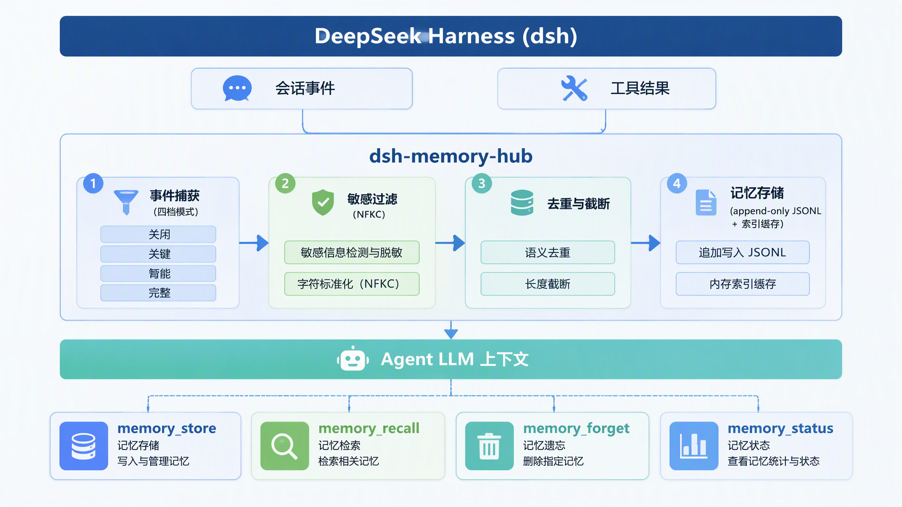
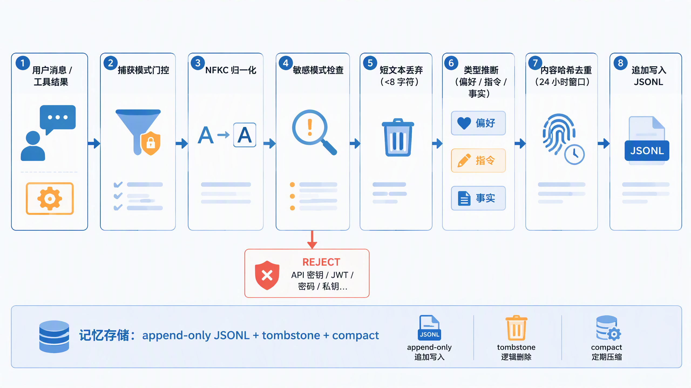
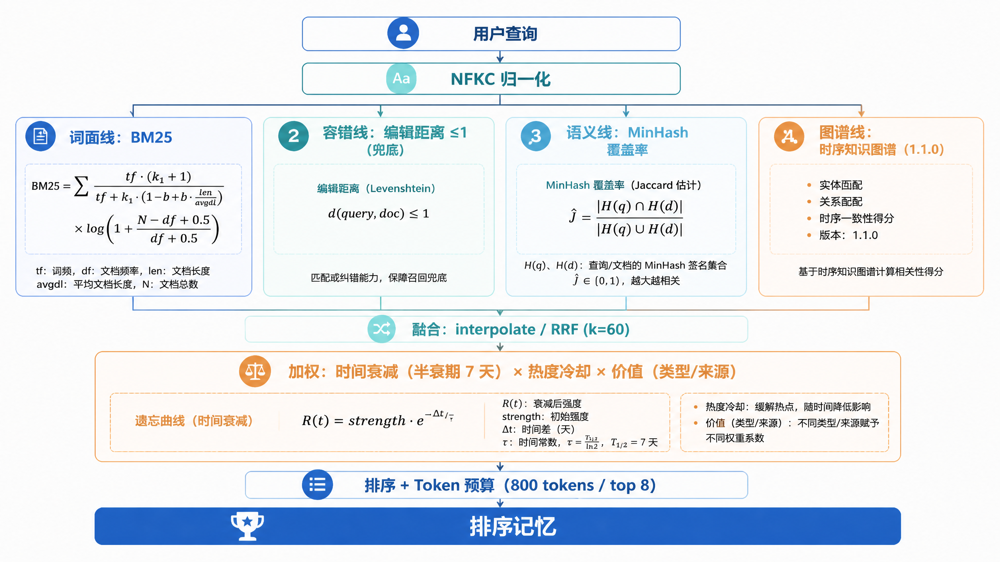
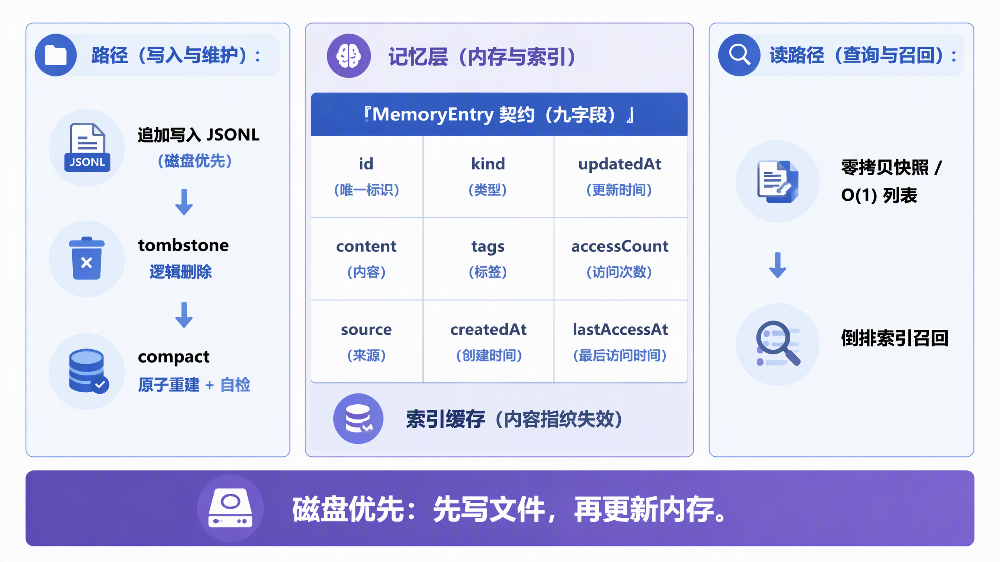
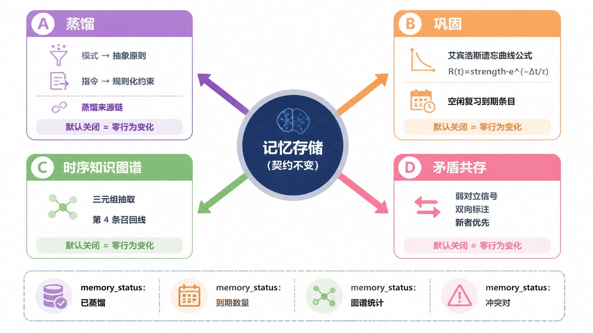

# dsh-memory-hub

**[简体中文](README.md) | [English](README.en.md)**


> **DeepSeek Harness 智能会话记忆中心** —— 让 Harness 越用越懂你。

`dsh-memory-hub` 是 DeepSeek Harness（dsh）的**本地优先、事件驱动**的跨会话记忆插件：它自动捕获会话中的用户偏好、工具执行结论，并以 4 个 Agent 可直接调用的工具提供显式记忆能力。新会话不再"从零开始"。

- **零外部服务**：记忆只落在本地 JSONL 文件，纯 TypeScript 实现，无第三方存储、无云端依赖；
- **事件驱动自动捕获**：基于 dsh 事件溯源层（`session/event` 火线）与工具执行管线（`tools/result`）智能提炼记忆，四档捕获力度可调；
- **Agent 可主动调用**：`memory_store` / `memory_recall` / `memory_forget` / `memory_status` 四工具，模型在需要时自行读写记忆；
- **隐私安全默认**：API Key、密码、JWT、私钥、数据库连接串等敏感模式一律拦截不入库；捕获仅针对真实用户输入，跳过插件注入与子代理上下文。

> 为什么是"市面空白"：官方 v0.2 发布说明将"加入个性化的长期记忆"列为后续方向；社区现有记忆插件均为早期/未验证/依赖外部生态。差异点论证详见 [`docs/ARCHITECTURE.md`](docs/ARCHITECTURE.md)。

---

## 系统总览

<div align="center">
  
  <br/>
  <sub><b>图 1</b> 总体架构：dsh 事件与工具结果 → 捕获过滤 → append-only 本地记忆库 → 四工具供给 Agent 上下文</sub>
</div>

## 目录

- [特性一览](#特性一览)
- [自动捕获管线](#自动捕获管线)
- [安装](#安装)
- [配置](#配置)
- [工具使用指南](#工具使用指南)
- [召回质量设计](#召回质量设计)
- [架构亮点](#架构亮点)
- [存储与一致性模型](#存储与一致性模型)
- [认知记忆系统](#认知记忆系统)
- [开发](#开发)
- [目录结构](#目录结构)
- [隐私与安全](#隐私与安全)
- [Roadmap](#roadmap)
- [License](#license)

---

## 特性一览

| 能力                           | 说明                                                                                                                                                                                                                                                                                                                                                                                                                                                                                                                                                                             |
| ------------------------------ | -------------------------------------------------------------------------------------------------------------------------------------------------------------------------------------------------------------------------------------------------------------------------------------------------------------------------------------------------------------------------------------------------------------------------------------------------------------------------------------------------------------------------------------------------------------------------------- |
| 显式记忆                       | `memory_store` 持久化决策 / 事实 / 偏好 / 指令，自动打标签、幂等 id                                                                                                                                                                                                                                                                                                                                                                                                                                                                                                              |
| 智能召回                       | `memory_recall` Okapi BM25 + **编辑距离 ≤1 容错（A1）** + **词根近似语义兜底（A2）** + **价值感知加权（A3）** + **热度半衰期冷却（A4）** + token 预算裁剪 + `kind` 过滤                                                                                                                                                                                                                                                                                                                                                                                                          |
| 事件自动捕获                   | 用户消息 → 偏好/指令；工具成功结果 → 事实；四档模式（off / conservative / balanced / aggressive）                                                                                                                                                                                                                                                                                                                                                                                                                                                                                |
| **真实数据接入**               | **启动时批量导入 Markdown 记忆文件（AGENTS.md/MEMORY.md/USER.md…）与会话 JSONL 日志（0.6.0）**：内容级幂等去重、kind 推断、敏感过滤，`开箱即有记忆`                                                                                                                                                                                                                                                                                                                                                                                                                              |
| 遗忘与治理                     | `memory_forget` 按 id 删除；`memory_status` 统计概览 + 运行指标 + 存储诊断；TTL 批量过期清理                                                                                                                                                                                                                                                                                                                                                                                                                                                                                     |
| 本地可靠存储                   | append-only JSONL + tombstone 逻辑删除 + compact 原子重建；**先落盘后入内存**，崩溃/写失败零残留                                                                                                                                                                                                                                                                                                                                                                                                                                                                                 |
| 可观测运维                     | `HubMetrics` 十项运行指标（捕获/拒绝/召回/遗忘/错误/丢弃）；有界背压队列；优雅关闭汇总日志                                                                                                                                                                                                                                                                                                                                                                                                                                                                                       |
| **记忆生命周期（1.0.0）**      | **supersede 取代协议（模块 A1）**：检测"改用/升级到"对立信号，被取代记忆召回降权 + 同现去重；**主题聚类视图（A2）**：`status` 输出聚合主题；**价值感知淘汰（A3）**：超上限按价值分淘汰，指令永不被自动淘汰                                                                                                                                                                                                                                                                                                                                                                       |
| **双引擎混合检索（1.0.0）**    | **词面（BM25）+ 容错（fuzzy）+ 语义（MinHash 覆盖率）三线评分**，`interpolate` 线性插值或 `rrf` Reciprocal Rank Fusion（k=60）融合（`semanticBoost` 开启时语义线叠加，默认关闭零行为变化）                                                                                                                                                                                                                                                                                                                                                                                       |
| **记忆认知层（1.1.0）**        | **层次蒸馏（模块 A）**：重复行为/偏好簇蒸馏为抽象原则、指令簇蒸馏为规则约束，`recall(expand)` 命中向下展开证据链；**巩固与遗忘曲线（模块 B）**：Ebbinghaus 间隔重复强度模型 + 空闲巩固调度；**时序知识图谱（模块 C）**：零依赖三元组抽取 + 第四召回线，词面全零但图可达条目可补录；**矛盾共存（模块 D）**：疑似反转事实并存显式标注、新者优先，修正时间线可回放                                                                                                                                                                                                                  |
| **推理升维（1.2.0）**          | **激活扩散推理线（模块 E，`inferEnabled`）**：spreading activation 工程化——查询实体沿图谱活跃出边多跳扩散（跳衰减 × 关系置信度 × 最旧边保守时效），最优路径链可回放（A—使用→B—依赖→C），asOf 时间线不可穿越失效关系，波束/链数双护栏有界；**召回溯源（模块 F，`explain`）**：每条命中附带 why——参与融合的召回线/各线贡献/权重因子，rrf 模式 Σ贡献 × lineBase 与最终分逐位精确相等                                                                                                                                                                                                |
| **时空完备（1.3.0）**          | **情景回放（模块 G，`asOf`）**：回到任意过去时刻召回——append-only JSONL 日志按文件序纯函数回放（`replayAsOf`），得到该时刻的精确知识状态（存在性/内容版本/取代与矛盾标注/访问热度），图谱按回放语料重建 T 时刻图视图（未来条目的边不存在），只读不写热度；**推理证据链（模块 H，`why.chains`）**：溯源从「infer 线贡献了分」升维到「凭什么推理」——infer 线参与的命中附带至多 3 条可回放路径链                                                                                                                                                                                    |
| **纵深防御·时间分析（1.4.0）** | **会话级加密存储（模块 I，`passphrase`/`DSH_MEMORY_PASSPHRASE`）**：记忆文件逐行 AES-256-GCM 认证加密落盘（scrypt 派生密钥 + 密钥记录头存盐，AAD 绑定格式版本）——静态保密（除头外零明文）+ 逐行防篡改（认证失败走损坏行隔离留证）；错口令/漏口令加载期显式失败；明文库原位加密迁移逐行原序重写（深回放历史完整保留）；compact 与加密共存；**时间分析（模块 J）**：`memory_status asOf` 历史快照视图（该时刻的记忆库统计，语料层封闭）+ `diffSince` T1↔T2 diff 视图（新增/消失/内容变更/取代矛盾/纯热度六类归因，确定性纯函数）                                                   |
| **边界突破（1.5.0）**          | **口令轮换与解密回退（模块 K，`DSH_MEMORY_NEW_PASSPHRASE`）**：逐行原序重写保深回放历史，失败不毒化写链，多进程锁护栏；**图维时间对账（模块 L，`graphDiff`）**：T1↔T2 图视图实体/关系级边差集；**本地向量第六召回线（模块 M，`vectorEnabled`）**：零依赖确定性 HNSW（fnv1a 层指派 + 论文多样性近邻选择 + 底层 2M），与 A2 同特征空间 TF·IDF 余弦，RRF 第六条秩/interpolate 叠加/why 溯源 `vector` 线；**双语实体抽取（模块 N）**：英文技术关系面 + 宾语连词拆分 + node.js 专名保形；**记忆时间轴（模块 O，`timeline`）**：按天分桶的新增/删除/更新/热度事件流 + 存活总量柱状走势 |
| 离线评估                       | **黄金语料评估（A5）+ 真实数据门（0.10.0 G6 / 1.0.0 G7-G8）+ 认知门禁（1.1.0 G9-G12）+ 推理门禁（1.2.0 G17-G18）+ 时空门禁（1.3.0 G19-G20）+ 纵深防御门禁（1.4.0 G21-G22）+ 边界突破门禁（1.5.0 G23-G25 / 1.5.1 G26）**：recall@k / MRR / NDCG + 4 维 81 组参数网格 + 26 项门禁（G1-G26，含蒸馏/图谱/巩固/矛盾共存/多跳推理/召回溯源/情景回放/加密零明文与回放 diff/HNSW 向量对拍与自检索/双语抽取/边界操作/可视化页自包含与注入安全、零行为回归与真实规模认知接地），`npm run eval` 一键可复算                                                                                  |

## 自动捕获管线

<div align="center">
  
  <br/>
  <sub><b>图 2</b> 事件驱动的捕获管线：从输入到入库的七道闸门，敏感内容与短文本在入口即被拦截</sub>
</div>

- **四档捕获力度**（`captureMode`）：`off`（完全关闭自动捕获）/ `conservative` / `balanced`（默认）/ `aggressive`；消息来源仅限真实用户输入，跳过插件注入与子代理上下文；
- **敏感拦截零豁免**：API Key / JWT / 私钥 / 连接串等模式匹配前先经 **NFKC 归一化 + 小写折叠**，全角/异体字符（`ｐａｓｓｗｏｒｄ`）无法绕过；短文本（<8 字符）直接丢弃；
- **内容级幂等入库**：`contentHash` 去重（24h 窗口内近似重复不再入库），kind 信号词推断（`preference` / `instruction` / `fact`）后追加写入 append-only JSONL，与显式 `memory_store` 三写入路径共用同一条目工厂（1.0.0）。

## 安装

将打包好的插件（`dsh-memory-hub-1.1.0.tgz`）放入可从插件页选择的位置，然后：

```bash
# 方式一：CLI（profile 替换为你自己的 profile 名，如 web）
dsh plugin --profile web add ./dsh-memory-hub-1.1.0.tgz

# 方式二：在桌面端「设置 → 插件」页点击「安装插件包」，选择该 tgz
```

安装后插件以 `memory-hub` id 并入 profile 配置树（`cordis.patch.yml` 声明），重载即生效。卸载即恢复原状，记忆文件保留在磁盘上。

## 配置

| 配置项                | 默认值              | 说明                                                                                                     |
| --------------------- | ------------------- | -------------------------------------------------------------------------------------------------------- |
| `storageDir`          | `~/.dsh/memory-hub` | 记忆库目录（留空用默认）                                                                                 |
| `maxEntryChars`       | `1000`              | 单条记忆最大字符数（导入同样受此上限约束）                                                               |
| `defaultRecallTokens` | `800`               | 召回默认 token 预算                                                                                      |
| `defaultRecallLimit`  | `8`                 | 召回默认条数上限                                                                                         |
| `captureMode`         | `balanced`          | 自动捕获力度：`off` / `conservative` / `balanced` / `aggressive`                                         |
| `autoTags`            | `true`              | 自动打标签                                                                                               |
| `dedupWindowMs`       | 24h                 | 去重窗口内近似重复内容不再入库                                                                           |
| `ttlDays`             | `0`                 | 记忆过期天数，`0` 永不过期；开启后每 6h + 启动时清理                                                     |
| `importSources`       | 空对象              | **0.6.0** 真实数据导入源（可选，见下）                                                                   |
| `supersedeMode`       | `off`               | **1.0.0** 被取代记忆识别：`off`（零变化）/ `auto`（检测对立信号，召回降权）                              |
| `semanticBoost`       | `false`             | **1.0.0** 语义线与词面线叠加融合（`true` 提升真实问句召回，默认关闭）                                    |
| `fusionMode`          | `interpolate`       | **1.0.0** 语义融合模式：`interpolate` 线性插值 / `rrf` 倒数排名融合                                      |
| `maxEntries`          | `0`                 | **1.0.0** 记忆库条目上限（`0` 不限；超出时配合 `autoEvict` 按价值淘汰）                                  |
| `autoEvict`           | `false`             | **1.0.0** 价值感知自动淘汰（仅 `maxEntries>0` 且超限时生效；instruction 永不淘汰）                       |
| `themes`              | `false`             | **1.0.0** `status` 输出主题聚类视图（默认关闭，避免额外计算开销）                                        |
| `distillMode`         | `off`               | **1.1.0** 记忆层次蒸馏：`off`（零变化）/ `auto`（空闲批处理蒸馏重复行为/偏好为抽象原则、指令为规则约束） |
| `consolidationMode`   | `off`               | **1.1.0** 认知巩固调度：`off`（零变化）/ `auto`（对有到期的高价值记忆执行间隔重复巩固复习）              |
| `graphEnabled`        | `false`             | **1.1.0** 时序知识图谱第四召回线（词面全零但图可达条目可补录；默认关闭零行为变化）                       |
| `conflictMode`        | `off`               | **1.1.0** 矛盾共存识别：`off`（零变化）/ `auto`（疑似反转事实并存并双向标注）                            |
| `conflictWindowMs`    | `30d`               | **1.1.1** 矛盾检测独立窗口（与 `dedupWindowMs` 解耦——信念反转常跨周，24h 窗会使跨周修正永远检测不到）    |
| `graphMaxEntities`    | `2000`              | **1.1.0** 图谱实体上限（防止任意文本记忆无限膨胀图谱）                                                   |
| `inferEnabled`        | `false`             | **1.2.0** 激活扩散推理第五召回线（沿图谱活跃出边多跳推理，最优路径链可回放；默认关闭零行为变化）         |
| `inferMaxHops`        | `2`                 | **1.2.0** 推理链最大跳数（`1` 直接关系 / `2` 一跳中介推理；钳制 1..3）                                   |
| `distillMinCluster`   | `3`                 | **1.1.0** 蒸馏最小簇成员数（低于该值不蒸馏，避免把孤例抽象成伪原则）                                     |
| `recallThreshold`     | `0.4`               | **1.1.0** 巩固可召回率阈值（预测可召回率低于该值且高价值 → 进入巩固队列）                                |

### 真实数据接入（0.6.0）

想让插件**开箱即有记忆**，在 profile 配置中把已有数据资产指给插件，启动时自动批量导入（内容级幂等，重复导入自动合并）：

```yaml
# profile patch 示例（cordis 配置树）
memory-hub:
  importSources:
    documents: # Markdown / 纯文本记忆文件（相对/绝对路径均可）
      - ~/workspace/AGENTS.md
      - ~/workspace/.agents/notes/MEMORY.md
      - ~/notes/my-harness-notes.md
    sessionLogs: # Harness 会话事件 JSONL 日志
      - ~/.dsh/sessions/archive/2026-09.jsonl
```

- **Markdown 文档**：标题/列表各自成块、连续段落聚合；按信号词推断 `instruction`/`preference`（其余 `generic`），以 `explicit` 来源入库；
- **会话 JSONL**：`user/message` / `assistant/message` 事件提取正文，以 `auto` 来源入库；损坏行跳过并计数，不阻断其余；
- **隐私与质量零豁免**：导入内容同样过敏感模式拦截（NFKC 归一化）与短块（<8 字符）丢弃；文件路径不存在/读取失败仅告警，插件照常启动；
- **未配置 `importSources` 时行为与 0.5.0 完全一致**（零导入），可随时增删路径后重载。

## 工具使用指南

这 4 个工具会自动暴露给模型，模型在以下场景（Agent 触发场景）应当调用：

- **`memory_store`**：用户说"记住……""以后都……"；或当一条决策/事实/偏好将影响未来会话时。
- **`memory_recall`**：新会话开场（调用一次，用当前任务的关键词检索过往约定）；用户提到可能聊过的旧话题时；拼写/措辞记不准确时尤其有效（容错 + 语义兜底）；可用 `kind` 限定只召回某种类型；**1.1.0 可选参数**：`expand`（蒸馏条目命中时向下展开源记忆证据链）、`graphEnabled`（图谱线显式开关）、`reinforce`（巩固复习语义，命中即模拟一次成功召回）、`asOf`（情景回放时间戳，回到该时刻只读召回——只含当时存在的记忆与当时的内容/取代状态，不更新热度）；**1.4.0**：`memory_status` 亦有 `asOf`（历史快照统计）与 `diffSince`（与 asOf 组成 T1↔T2 diff 视图：新增/消失/内容变更/取代矛盾/纯热度）；**1.5.0 可选参数**：`vector`（启用本地 HNSW 向量第六召回线，逐次覆盖配置默认 `vectorEnabled`）；**1.2.0 可选参数**：`infer`（启用激活扩散推理线，逐次覆盖配置默认）、`explain`（输出每条命中的召回溯源 why：参与融合的召回线/各线贡献/权重因子；**1.3.0 起 infer 线参与的命中附带 `why.chains` 推理证据链**，路径逐边可回放）。
- **`memory_forget`**：用户明确要求删除某条记忆时（id 来自 `memory_recall` / `memory_status`）。
- **`memory_status`**：需要了解记忆库规模、分布、存储占用，或排查捕获/召回是否按预期运行时（含 `metrics` 与存储 `diagnostics`）；**1.4.0**：`asOf` 看历史时刻的库况、`diffSince`（与 `asOf` 组合）看两时刻之间记忆库发生了什么；**1.5.0**：`graphDiff`（diff 附实体/关系级图边对账）、`timeline`（按天分桶的记忆事件流与总量走势柱状图）；**1.5.1**：`exportHtml`（导出自包含 HTML 可视化页——时间轴柱状视图 + 浏览器本地即时评分检索页，写入存储目录并返回路径）。

工具输出均为**结构化 JSON + 一段文本渲染**，可直接进入上下文，token 开销受预算控制。

## 召回质量设计

<div align="center">
  
  <br/>
  <sub><b>图 3</b> 召回评分的四线并行结构与融合链路（0.5.0 三线 + 1.1.0 时序图谱第四线）</sub>
</div>

```
score = BM25(query, memory) × 时间衰减(半衰期 7 天) × 热度(生命冷却) × 价值感知(类型/来源)
BM25  = Σ tf·(k1+1)/(tf + k1·(1 − b + b·len/avgdl)) × log(1 + (N − df + 0.5)/(df + 0.5))   （k1=1.2, b=0.75）
热度  = 1 + 0.1·log1p(accessCount) · exp(−Δ(lastAccessAt)/半衰期)   （默认半衰期 7 天，`heatHalfLifeMs` 可注入）
价值  = 类型系数（指令 1.25 > 决策 1.15 > 偏好 1.05 > 事实 1.0 > 泛化 0.95）× 来源系数（显式 1.1 > 自动 1.0）
```

- 中文按 **2-gram + 英文按单词** 双路分词（查询与索引统一经 **NFKC 规范化**；英文停止词过滤）；词频饱和 + 文档长度归一化，长尾文档不再天然压过精炼短记忆；
- **A1 容错检索**：查询英文词（≥4 字符）生成编辑距离 ≤1 变体（删除/交换/替换/插入），仅当精确 BM25 零命中时以 0.5 折扣兜底——`delpoy` 也能找到 `deploy` 的记忆；
- **A2 语义兜底**：英文 token 展开字符 3-gram 特征（随索引缓存 k=16 MinHash 签名供 LSH 剪枝），词面全零命中时按**精确查询覆盖率**（≥0.45）以 0.3 权重召回——词根/形态变体（`deploy` ↔ `deployment`）不再漏；
- **A3 价值感知**：指令/决策/显式记忆天然权重更高，重要的事不被流水账事实淹没（`significance` 可关闭）；
- **A4 热度生命周期**：久未访问的高频旧记忆按 Ebbinghaus 遗忘曲线指数冷却，近期验证过的记忆保持热度，新相关信息有机会被想起；
- 召回按分数排序后执行 **token 预算裁剪**（默认 800 token / 8 条），防止记忆撑爆上下文；
- 命中即热度 +1 并更新最近访问时间（仅契约字段落盘，运行时 `score` 绝不写入存储）；
- 评分基准时间与全部参数（k1/b/半衰期/开关）可注入（同一基准下结果可复算），便于测试与批量评估（`npm run eval`）。

## 架构亮点

- **真实数据接入（0.6.0）**：`src/memory/importer.ts` 纯函数导入层——Markdown 记忆文档切块（标题/列表/段落聚合、索引行跳过）、会话 JSONL 宽容解析（user/assistant 事件、损坏行计数不阻断）、内容哈希幂等 id（`imp-${contentHash}`，跨来源/跨时间自动合并）、kind 信号词推断、敏感过滤与 maxChars 截断零豁免；插件可选配置 `importSources` 启动导入，失败仅告警不阻断，未配置时行为与 0.5.0 完全一致；
- **统一错误基础设施（0.7.0）**：`errorMessage` 为全局唯一错误信息入口（`MemoryHubError` → `CODE: message` 保留稳定错误码、Error → message、其余 → String 兜底），入口 9 处告警日志统一；错误码契约（`ErrorCodes`）与 `toMemoryHubError` 全部有 100% 覆盖的专项测试；
- **零重复实现（0.7.0）**：内容块文本提取归一至 **唯一实现** `src/memory/text.ts`（index.ts 与 importer.ts 复用，re-export 保持导入兼容）；捕获入库管线（敏感过滤/去重/截断/workspace/指标）自入口拆出为 `src/memory/ingest.ts`，可直接单测，index.ts 聚焦"接线"；
- **逐个实现提纯与可观察化（0.7.0）**：src 非空类型断言从 69 处降至 4 处（降幅 94%，剩余为附算法不变式证明的滚动数组收敛）、eval 报告版本从 `package.json` 自动读取（杜绝硬编码漂移）、bench 质量对比命中率真实落 stdout（`[bench]` 前缀）、覆盖率阈值与实测对齐并固化进 CI（lines ≥94.71 / branches ≥89.71 / functions ≥95.14）；
- **插件生命周期与错误路径全量可测（0.8.0）**：`mountPlugin()` 显式组装插件对象驱动 cordis 真实 disposer 链（vitest ESM 转换环境适配），正常/异常卸载、工具注册失败不阻断、store open 失败不崩溃、prune 三路径、捕获队列背压 256 边界、ttlDays 定时器全分支单测（index.ts 分支 70.21 → 85.07）；
- **工具输出契约白盒化（0.8.0）**：四工具 `render(args, value)` 直调单测覆盖全部输出形态（status 空库/全形态、recall 零/多命中、forget removed/not found、store workspace/tags/截断），工具函数覆盖 71.42 → 100，输出可断言、可回归；
- **防御分支闭环与断言清零（0.8.0）**：engine 18 处守卫分支 + 三类不可达死代码经不变式证明移除（branches 100%）、store 四类容错故障注入直测、`status` 双断言提纯为类型守卫、`recall` 输出契约抽接口复用、`index` 注册类型精确化——src 断言计数不增，覆盖率阈值与实测同步升至 lines ≥96.5 / branches ≥95 / functions ≥97；
- **薄弱项深度闭环（0.9.0）**：DEEP-AUDIT 七维度审计实锤的 16 项薄弱项（P0×3 / P1×6 / P2×7）全部闭环——漂移免疫词法（强度词单一事实源编译派生，裸「务必/一定」conservative 漏记修复）、共享默认隔离（未标注 workspace = 全局共享，tools/result 捕获按 Agent 会话 cwd 溯源）、双尺度时间语义（默认 ttlDays=0 关闭评分衰减，decay 可关闭、半衰期可注入）、写入路径工程化（批内瞬时去重 + dispose 捕获栅栏 + recall 热度合并回写抗刷且错误上浮 metrics）、签名候选预筛（MinHash 从预留落地为真实剪枝，评分语义不变）、契约显式化（autoTags 生效 / importer isUser 消费 / mode 三档 / strict 遗忘抛 NOT_FOUND / .corrupt 幂等留证 / 快照零拷贝 / 非法 kind 错误形态统一）——324 测试全绿，branches 96.1 → 97.87，eval 六门限与 bench 全过；
- **真实数据接地（0.10.0 新增 G6）**：离线质量评估从"合成语料自证"升级为**真实数据验证 + 合成语料回归**双轨——真实官方文档（Node.js v26.10.0 path/os 固定 tag 快照，SHA-256 固化，随仓库分发、评测不联网）经 `planImport` **生产同路径**入库（329 条真实记忆），24 个真实 API 问句按语义锚标注召回，门限冻结 recall@1 ≥ 0.75 / recall@3 ≥ 0.85 / recall@5 ≥ 0.95——对接真实数据后召回质量依然被验证，详见 [`docs/GROUND-0.10.md`](docs/GROUND-0.10.md)；
- **记忆生命周期与冲突感知（1.0.0 模块 A，市面上没有）**：supersede 取代协议（语义单一事实源词表，`auto` 模式识别"改用/升级到"对立信号 → 新记忆打 `supersede:`、旧记忆打 `superseded-by:` → 召回时被取代记忆**降权 + 同现去重**，`supersededPenalty` 可调）、主题自动聚类运行时视图（仅 `themes` 开启时在 `status` 计算，不持久化）、价值感知自动淘汰（`maxEntries` + `autoEvict`，按冷热 + 显著性淘汰，instruction 永不淘汰），方案全文见 [`docs/DESIGN-1.0.md`](docs/DESIGN-1.0.md)；
- **双引擎混合检索（1.0.0 模块 B，RRF 融合）**：词面线（BM25）/ 容错线（编辑距离 ≤1）/ 语义线（MinHash 覆盖率两级守卫）三线评分，`semanticBoost` 开启时可叠加或按 `rrf`（k=60）融合，真实问句召回率进一步提升（G6 49 问句门限全绿）；
- **记忆认知层（1.1.0 模块 A-D，市面上没有的「记忆认知」）**：把记忆从平面仓库升维为认知记忆系统——**层次蒸馏**（模块 A：重复行为/偏好簇归纳为抽象原则、指令簇蒸馏为规则约束，`distilled-from` 证据链 + recall expand 向下展开；冲突簇守卫 0 蒸馏防伪原则）、**认知巩固与遗忘曲线**（模块 B：Ebbinghaus 间隔重复强度模型 `R(t)=strength·e^(−Δt/τ)`，空闲批处理对到期高价值记忆巩固复习，协议内更新访问历史、零新字段）、**时序知识图谱**（模块 C：零依赖规则引擎抽取中英主观三元组，`TemporalGraph` 增量维护 + supersede 时间线失效边，成为与词面/容错/语义并列的**第四召回线**——词面全零但图可达条目可补录）、**信念修正与矛盾共存**（模块 D：疑似反转事实并存双向标注、召回双方都保留且新者优先显式输出 `conflicts`，与 supersede 强对立词表互斥，修正时间线随时间戳回放）；对标 MemGPT / GraphRAG / HippoRAG / Zep Graphiti / Generative Agents，全部**纯函数 + 零新增运行时依赖**落地，方案全文见 [`docs/DESIGN-1.1.md`](docs/DESIGN-1.1.md)；
- **推理升维（1.2.0 模块 E/F，「检索」→「推理」）**：把召回从「哪些记忆与查询相似」升维到「能从记忆推出什么」——**激活扩散推理线**（模块 E：查询实体沿图谱活跃出边多跳扩散，逐跳衰减 × 关系置信度 × 最旧边保守时效，每个终结实体保留可回放的最优路径链；asOf 时间线正确——推理不穿越被取代/失效的关系；波束 + 链数双护栏，hub 扇出有界；interpolate 线性叠加 / RRF 第五条秩融合）与**召回溯源**（模块 F：`explain=true` 时每条命中附带 why——参与融合的召回线/各线贡献/公共权重因子，rrf 模式下贡献与最终分逐位精确相等；纯读侧注记，评分算术路径一字节未动）；方案全文见 [`docs/DESIGN-1.2.md`](docs/DESIGN-1.2.md)；
- **时空完备（1.3.0 模块 G/H，「当前」→「任意时刻」）**：把召回的时间维度补全——**情景回放**（模块 G：append-only JSONL 日志按文件序纯函数回放 `replayAsOf`，写入时刻由写入协议锚定 `max(updatedAt, lastAccessAt)`，得到任意过去时刻的精确知识状态：存在性/内容版本/取代与矛盾标注/访问热度；图谱按回放语料重建 T 时刻图视图；只读不写热度、不污染索引缓存）与**推理证据链**（模块 H：`why.chains` 把 1.2.0 藏在引擎内部的推理链暴露到工具面——infer 线参与的命中附带至多 3 条逐边可回放的路径链）；方案全文见 [`docs/DESIGN-1.3.md`](docs/DESIGN-1.3.md)；
- **纵深防御与时间分析（1.4.0 模块 I/J，「明文」→「密文」、「快照」→「变更审计」）**：**会话级加密存储**（模块 I：逐行 AES-256-GCM 认证加密 + scrypt 派生密钥 + 原位迁移保深回放历史——roadmap 收官）与**时间分析**（模块 J：status asOf 历史快照 + T1↔T2 diff 视图六类归因）；方案全文见 [`docs/DESIGN-1.4.md`](docs/DESIGN-1.4.md)；
- **边界突破（1.5.0 模块 K/L/M/N/O，把设计文档划出的全部剩余边界收敛）**：**口令轮换**（模块 K：加密→新口令/空口令解密回退/明文→加密四态，逐行原序重写保深回放，失败文件保持原状且写链不毒化）、**图维 diff**（模块 L：diffGraphs 双侧重建图视图的活跃边差集，与条目维 diffReplay 互补）、**本地 HNSW 向量第六线**（模块 M：确定性层指派 + 论文 Algorithm 4 多样性近邻选择——单纯最近 M 裁剪在簇状语料上图坍缩为不可达子网，此为实现关键发现；真实规模校准 3333 文档 HNSW vs 暴力全量 top-10 全一致）、**双语抽取**（模块 N：returns/throws/emits/基于/支持… 双语关系面 + 连词拆分 + 标识符点保形）、**记忆时间轴**（模块 O：按天分桶事件流 + 总量走势柱状渲染）、**可视化检索页**（模块 P（1.5.1）：`exportHtml` 导出自包含 HTML——时间轴柱状视图 + 浏览器本地评分检索页，确定性渲染 + 注入安全 + 零外链）；方案全文见 [`docs/DESIGN-1.5.md`](docs/DESIGN-1.5.md)；
- **事件溯源（Event Sourcing）**：不轮询、不侵入 Agent Loop，订阅 `session/event` 火线获取用户消息，订阅 `tools/result` 获取工具执行结果，纯增量学习；
- **有界背压捕获队列**：串行 FIFO promise 链 + 上限 256，事件洪水丢弃最早期任务并计数（`dropped`），进程内存永远有界，单条失败不阻断后续；
- **读一致性（先落盘后入内存）**：所有写路径先 `appendFile` 成功再变更内存 Map，并发读者永远只看到已确认落盘的状态，写失败天然零残留；
- **倒排索引缓存（`IndexCache`）**：召回按存储 `revision` + **内容指纹**（id/content/tags 的 sha256）失效：同版本热度更新复用旧索引、内容变化才重建，语料未变时 O(查询) 完成召回，免全量重建；
- **Okapi BM25 排序检索**：词频饱和 + 文档长度归一化（长文档不再天然占优），配合查询 NFKC 规范化与英文停止词过滤，精炼记忆排在长尾之前（实测 top@1 命中率提升至 100%，详见 `docs/CENTURY-0.4.md` 附录 A）；
- **容错检索（A1）**：编辑距离 ≤1 查询扩展（Damerau-Levenshtein 四类单编辑、过滤停用词与词典外词），精确零命中才兜底且五折计入，正确率与召回率兼得；
- **近似语义召回（A2）**：字符 3-gram 特征空间 + MinHash 签名缓存（LSH 剪枝资产），评分用零误差精确覆盖率规避小特征集 MinHash 方差——无外部 embedding 服务的本地语义层；
- **记忆价值感知（A3）**：指令/决策/显式记忆显著性加权，纯函数常量权值可复算、可关闭；
- **热度生命周期（A4）**：指数遗忘曲线冷却（默认半衰期 7 天），`用进废退`——冷却/复活闭环：命中即 `bumped()` 同步更新 `lastAccessAt`，久未访问的高频记忆恢复出头机会；
- **离线质量评估套件（A5 + 0.10.0 G6 + 1.0.0 G5/G7/G8 + 1.1.0 G9-G12）**：固定 seed 黄金语料（精确/模糊/语义/热度四场景）+ recall@k/MRR/NDCG 指标 + 4 维 81 组参数网格敏感性（G5：k1×b×heatHalfLifeMs×semanticWeight）+ **真实官方文档语料（Node.js v26.10.0 快照）经生产同路径入库的 G6 真实数据门**（G7 五类扰动鲁棒性 / G8 生命周期聚类 / G9-G12 蒸馏·图谱·巩固·矛盾共存认知门禁），`npm run eval` 一键复算并生成 Markdown 报告；
- **零拷贝快照（0.9.0）**：`list()` 直接返回已排序共享缓存引用，写操作置脏后下次访问重建新数组（copy-on-write），读路径 O(1) 零拷贝、外部修改不污染新状态，高频召回/状态查询零浪费；
- **运行指标体系（`HubMetrics`）**：捕获入库 / 显式存储 / 召回次数与命中 / 遗忘 / 敏感拒绝 / 去重拒绝 / TTL 清理 / 背压丢弃 / 错误十项计数；`memory_status` 实时快照、卸载时汇总输出，健康度一目了然；
- **Unicode 归一化安全**：敏感检测先做 NFKC 归一化 + 小写折叠，全角/异体字符（`ｐａｓｓｗｏｒｄ`）无法绕过过滤；
- **契约纯净**：`MemoryEntry` 运行时类型守卫（`isMemoryEntry` / `parseMemoryEntry`）；召回热度更新显式 pick 契约字段，运行时 `score` 永不落盘；
- **append-only 存储**：写入 O(1) 追加、tombstone 批量逻辑删除（`removeMany`）、compact 阈值触发原子重建（tmp + rename），重建后自检行数，compact 失败仅告警不吞写；隐私文件 0600；
- **存储自愈与迁移闭环（0.4.0）**：损坏 JSONL 行跳过时自动隔离留证至 `<file>.corrupt`（失败仅告警）；`exportAll()` 全量导出 + `importAll()` 导入组成跨设备迁移闭环，数据往返无损；
- **Cordis 生命周期一等公民**：所有监听器、工具注册、定时器与存储句柄都以 effect 形式返回，异步 disposer 等待存储关闭，插件卸载自动清理，可安全热重载；
- **类型安全与工程护栏**：`TypeScript strict` + `exactOptionalPropertyTypes`/`verbatimModuleSyntax` 等前沿开关 + eslint 9（typescript-eslint）+ prettier + vitest 覆盖率阈值守护（lines ≥96.5 / branches ≥95 / functions ≥97 / statements ≥96.5，与 0.8.0 实测同步冻结）+ GitHub Actions CI（含独立 `npm run eval` 质量门限 job）+ `npm run check` 一键全检，真实 dsh 生态类型，0 个 `any` 泄漏到业务逻辑；
- **可扩展存储**：存储层实现 `MemoryStore` 接口，新增能力（`removeMany`/`revision`/`diagnostics`/`exportAll`）均为可选成员，未来可无侵入替换为 SQLite / 向量库 / MCP 后端；
- **错误分级**：统一 `MemoryHubError`（稳定错误码 EMPTY_CONTENT / SENSITIVE_CONTENT / STORE_CLOSED / STORE_WRITE_FAILED / STORE_READ_FAILED / …），工具侧可编程处理；
- **防御式运行**：存储打开失败不阻塞插件加载；事件负载解析失败仅告警；损坏 JSONL 行自动跳过并计数。

## 存储与一致性模型

<div align="center">
  
  <br/>
  <sub><b>图 4</b> 存储模型：磁盘先行、逻辑删除、原子重建与零拷贝读路径</sub>
</div>

- **写路径（disk-before-memory）**：所有写操作先 `appendFile` 成功、再变更内存 Map，崩溃/写失败零残留；删除走 tombstone 逻辑标记（`removeMany` 批量），compact 达阈值触发 tmp + rename 原子重建并自检行数；
- **读路径（零拷贝）**：`list()` 直接返回已排序共享缓存引用（copy-on-write），外部修改不污染新状态；召回按存储 `revision` + 内容指纹（sha256）失效 IndexCache，语料未变时 O(查询) 完成；
- **契约与迁移**：`MemoryEntry` 九字段运行时类型守卫、运行时 `score` 永不落盘；损坏行自动隔离留证（`.corrupt`）+ `exportAll` / `importAll` 无损迁移闭环；隐私文件权限 0600、目录 0700。

## 认知记忆系统

<div align="center">
  
  <br/>
  <sub><b>图 5</b> 1.1.0 认知记忆系统：四模块以 MemoryStore 为核心辐射，全部默认关闭 = 零行为变化</sub>
</div>

- **层次蒸馏（模块 A）**：重复行为/偏好簇归纳为抽象原则、指令簇蒸馏为规则约束（`distillMinCluster=3` 防伪原则），`distilled-from` 证据链沉淀，`recall(expand)` 命中向下展开原始记忆；
- **认知巩固与遗忘曲线（模块 B）**：Ebbinghaus 间隔重复强度模型 `R(t)=strength·e^(−Δt/τ)`，空闲批处理对到期高价值记忆巩固复习，协议内更新访问历史、零新字段（`recallThreshold=0.4` 控制入队）；
- **时序知识图谱（模块 C）**：零依赖三元组抽取 + `TemporalGraph` 增量维护，成为第四召回线——词面全零但图可达条目可补录（`graphMaxEntities=2000` 防膨胀）；
- **信念修正与矛盾共存（模块 D）**：疑似反转事实并存双向标注、召回双方保留且新者优先显式输出 `conflicts`，与 supersede 强对立词表互斥，修正时间线可随时间戳回放；
- **零行为变化保证**：四个模块默认全部关闭（`distillMode`/`consolidationMode`/`graphEnabled`/`conflictMode`），`memory_status` 扩展输出 `distilled` / `dueCount` / `graph stats` / `conflictPairs` 可观测指标。

### 推理升维（1.2.0，模块 E/F）

- **激活扩散推理线（模块 E，`inferEnabled` + `inferMaxHops`，默认关闭）**：认知科学 spreading activation 的工程化——查询实体沿时序图谱**活跃**出边多跳扩散（每跳 ×0.5 衰减 × 关系置信度 × 最旧边保守时效），每个终结实体保留最优路径链（`A—使用→B—依赖→C` 可回放）；asOf 时间线硬约束（推理不穿越失效关系，含复活语义）；波束 16 + 链数 16 双护栏，hub 扇出有界；interpolate 线性叠加 / RRF 第五条秩融合；
- **召回溯源（模块 F，`memory_recall explain` 参数）**：每条命中附带 `why`——参与融合的召回线（bm25/fuzzy/semantic/graph/infer）、各线贡献与公共权重因子；rrf 模式下 `Σ贡献 × lineBase` 与最终分**逐位精确相等**；渲染追加 `（溯源: rrf ← bm25=0.0161 + infer=0.0164）`；
- 设计全文见 [`docs/DESIGN-1.2.md`](docs/DESIGN-1.2.md)，真实规模门禁 G17-G18 锁定。

### 时空完备（1.3.0，模块 G/H）

- **情景回放（模块 G，`memory_recall asOf` 参数）**：回到任意过去时刻召回——`replayAsOf` 纯函数按文件序回放 append-only JSONL 日志，行写入时刻由既有写入协议锚定（内容/标注写入 `updatedAt`、热度回写 `lastAccessAt`），得到该时刻的**精确知识状态**（存在性 / 内容版本 / 取代与矛盾标注 / 访问热度全维度）；tombstone 行携带删除时刻（旧格式保守视为已删除）；图谱按回放语料重建 T 时刻图视图（未来条目的边不存在、取代状态即当时快照）；只读回放不写热度、绕过索引缓存；无 `listAsOf` 实现的存储降级为 `createdAt` 过滤；
- **推理证据链（模块 H，`explain` 输出 `why.chains`）**：溯源从「infer 线贡献了分」升维到「凭什么推理」——infer 线参与融合的命中附带至多 3 条推理链（路径逐边 `from/relation/to/confidence/occurredAt`，直接回放 `A—使用→B—依赖→C`）；收集机制为纯出参（`chainsOut`），评分路径零改动；
- 渲染示例：`[memory recall @2026-10-20T00:00:00.000Z] 3 hit(s) … - (fact) …（溯源: interpolate ← infer=0.0164）（推理: 事务机制 —~属于→ mvcc —~依赖→ postgresql (0.42)）`；
- 设计全文见 [`docs/DESIGN-1.3.md`](docs/DESIGN-1.3.md)，真实规模门禁 G19-G20 锁定（3333 条真实文档语料分阶段写入门禁：分时刻快照手算一致 + 未来条目词面/图边不穿越）。

### 纵深防御与时间分析（1.4.0，模块 I/J）

- **会话级加密存储（模块 I，配置 `passphrase` 或环境变量 `DSH_MEMORY_PASSPHRASE`）**：开启后记忆文件逐行 AES-256-GCM 认证加密（scrypt N=16384 派生密钥；首行密钥记录头存盐与 KDF 参数；AAD 绑定格式版本）——**静态保密**（除头外零明文，备份/镜像/误提交不再泄漏正文）+ **逐行防篡改**（认证失败走既有损坏行隔离留证通道）；错口令与漏口令在加载期显式失败（绝不表现为空库）；**明文库原位加密迁移**逐行原序重写（append-only 深回放历史——旧内容版本与删除时刻——完整保留，仅换密文外衣）；compact 与加密共存；混合文件容忍（迁移中间态可读写）；口令丢失 = 数据不可恢复（无后门）；进程内仍为明文（运行时必需，承诺的是静态保密）；**口令轮换与解密回退（1.5.0 模块 K）**：设 `DSH_MEMORY_NEW_PASSPHRASE` 启动一次即轮换（非空 = 换口令/启用加密，空串 = 解密回退明文），逐行原序重写保深回放历史、失败文件保持原状、多进程写锁护栏，改完移除变量；
- **时间分析（模块 J，`memory_status` 新参数）**：`asOf` 历史快照视图——该时刻的记忆库统计（只含当时存在的记忆/当时内容版本与取代矛盾状态，语料层字段封闭不掺运行时观测，冷热分层以 asOf 为现在）；`diffSince`（与 `asOf` 组成 T1↔T2 diff 视图）——期间记忆库发生了什么：新增/消失/内容变更/取代矛盾/纯热度六类归因（`diffReplay` 纯函数确定性），明细 ≤20 样本、计数完整；降级存储按 createdAt 近似（removed 恒空，口径已声明）；
- 渲染示例：`[memory status diff 2026-10-24T… → 2026-10-29T…] +2 -1 ~0 (heat 1)`；`[memory status @2026-10-24T…] 401 entries`；
- 设计全文见 [`docs/DESIGN-1.4.md`](docs/DESIGN-1.4.md)，真实规模门禁 G21-G22 锁定（400 条真实语料落盘零明文多锚点抽验 + 迁移保深回放；G19 同构分阶段时间线三分区 diff 与手算一致）。

## 开发

```bash
npm install          # 安装依赖
npm run typecheck    # tsc --noEmit 类型检查
npm run lint         # eslint 静态检查
npm run format:check # prettier 格式检查
npm test             # vitest run（612 个单测/集成/加载冒烟测试 + 70 项 eval 评估门禁，合计 682）
npm run eval         # A5 离线质量评估（黄金语料 + 参数网格 + G1-G20 门禁，一键可复算）
npm run test:coverage # vitest 覆盖率（含阈值守护：lines/statements ≥98 / functions ≥98 / branches ≥93，1.3.0 按实测再冻结（1.4.0 新源文件维持））
npm run check        # 一键全检：verify:realdata + typecheck + lint + format + test
npm run build        # tsup 产出 ESM + d.ts 到 lib/
npm run bench        # vitest bench 性能基准（recall 召回/索引 0.4.0、知识图谱 10K 构建/P95、蒸馏批处理）
npm pack             # 产出 dsh-memory-hub-1.4.0.tgz
```

## 目录结构

```
dsh-memory-hub/
├── src/
│   ├── index.ts              # 插件入口：服务接线、有界捕获队列、指标、生命周期、启动导入（0.6.0）
│   ├── config.ts             # schemastery 配置 Schema（配置面板自动生成，含可选 importSources）
│   ├── errors.ts             # MemoryHubError + 稳定错误码 + errorMessage/toMemoryHubError（统一错误基础设施，0.7.0）
│   ├── memory/
│   │   ├── types.ts          # MemoryEntry 契约 + 运行时守卫（isMemoryEntry/parse/to）+ RecallOptions
│   │   ├── entry-factory.ts  # 1.0.0 统一记忆条目工厂（id 组装/tags 清洗/截断/workspace 注入/时间戳单一语义，三写入路径共用）
│   │   ├── store.ts          # append-only JSONL + tombstone（1.3.0 起带删除时刻）+ replayAsOf 情景回放 + removeMany + compact 自检 + exportAll + 损坏行隔离留证
│   │   ├── engine.ts         # 倒排索引 + BM25 + A1 容错变体 + A2 语义特征/MinHash + A3 价值加权 + A4 热度生命周期 + IndexCache（纯函数）
│   │   ├── importer.ts       # 0.6.0 真实数据接入（Markdown 切块 / 会话 JSONL 提取 / kind 推断 / 幂等规划，纯函数）
│   │   ├── text.ts           # 0.7.0 内容块文本提取唯一实现（index/importer 共享，消除重复实现）
│   │   ├── ingest.ts         # 0.7.0 捕获入库管线（敏感/去重/截断/workspace/指标，独立可测）
│   │   ├── metrics.ts        # HubMetrics 运行指标聚合器（零依赖、可快照）
│   │   ├── capture.ts        # 事件捕获启发式 + NFKC 归一化敏感过滤
│   │   ├── distill.ts        # 1.1.0 记忆层次蒸馏（聚类/归纳/分层/证据链引用，纯函数）
│   │   ├── consolidation.ts  # 1.1.0 认知巩固与遗忘曲线（强度模型/到期判定，纯函数）
│   │   ├── graph.ts          # 1.1.0 时序知识图谱（三元组抽取/TemporalGraph/第四召回线 + 1.1.1 实体归一层）
│   │   ├── infer.ts          # 1.2.0 激活扩散推理线（多跳最优路径链/asOf 时间线/波束有界，第五召回线）
│   │   ├── crypto.ts         # 1.4.0 逐行 AEAD 编解码器（scrypt KDF + AES-256-GCM 信封 + 密钥记录头）
│   │   ├── conflict.ts       # 1.1.0 信念修正与矛盾共存（弱对立信号/双向标注）
│   │   └── cognitive.ts      # 1.1.0 A-D 认知模块入口聚合 + 空闲巩固/蒸馏调度
│   └── tools/                # memory_store / recall（含 kind 过滤 + 1.1.0 expand/graphEnabled/reinforce + 1.3.0 asOf 情景回放 + 1.2.0 infer/explain 溯源与 why.chains 证据链）/ forget / status（+ 1.1.0 distilled/graph/dueCount/conflictPairs 可观测 + 1.4.0 asOf 历史快照与 diffSince diff 视图）
├── eval/                     # A5 离线质量评估套件（corpus 黄金语料 / realdata 真实数据门 G6 / metrics 指标 / G1-G26 门限测试，含 bit-exact 零行为回归 + G13-G16 真实规模认知接地 + G17-G18 推理门禁 + G19-G20 时空门禁 + G21-G22 加密与时间分析门禁 + G23-G25 边界突破门禁 + G26 可视化页门禁）
├── bench/                    # vitest bench 性能基准（recall 召回/索引 0.4.0、知识图谱 10K 构建/P95、蒸馏 1K/10K 批处理）
├── test/                     # 612 个单元 + 集成 + 加载冒烟测试（含 0.8.0/0.9.0 升维专场 + 1.1.0 工具新参数断言 + 1.2.0 推理线/溯源专场 + 1.3.0 情景回放/证据链专场 + 1.4.0 加密/时间视图专场 + 1.5.0 轮换/图维/时间轴/双语/向量专场 + 1.5.1 可视化导出专场 + coverage-1.3 系列覆盖率阈值回归五件套）
├── docs/ARCHITECTURE.md      # 架构设计与市场空白论证（含 0.1.0→1.0.0 全版本演进 + 1.0.0 世纪升维）
├── docs/DESIGN-1.1.md        # 1.1.0 认知记忆系统设计（模块 A-D：蒸馏/巩固/时序图谱/矛盾共存 + G9-G12 门限）
├── docs/DESIGN-1.2.md        # 1.2.0 推理升维设计（模块 E/F：激活扩散推理线/召回溯源 + G17-G18 门限）
├── docs/DESIGN-1.3.md        # 1.3.0 时空完备设计（模块 G/H：情景回放/推理证据链 + G19-G20 门限）
├── docs/DESIGN-1.4.md        # 1.4.0 纵深防御与时间分析设计（模块 I/J：加密存储/时间分析 + G21-G22 门限）
├── docs/DESIGN-1.5.md        # 1.5.0/1.5.1 边界突破设计（模块 K/L/M/N/O/P：口令轮换/图维 diff/向量第六线/双语抽取/时间轴/可视化检索页 + G23-G26 门限）
├── docs/DEEP-AUDIT.md        # 0.8.0 终态全模块薄弱项七维度深度审计
├── docs/history/             # 历史版本设计快照归档（EVOLUTION/CENTURY/QUALITY/LIFT/GROUND/REALDATA/INNOVATION/DESIGN-0.9/DESIGN-1.0 等 13 篇 + 质量报告）
├── .github/workflows/ci.yml  # GitHub Actions CI（node 18/20/22 × 全检 + coverage + quality-eval 门限）
├── CHANGELOG.md              # Keep a Changelog 版本记录
├── eslint.config.js          # eslint 9 flat config（typescript-eslint 严格）
├── .prettierrc.json          # prettier 格式约定
├── vitest.config.ts          # vitest + 覆盖率阈值（lines/statements ≥98 / functions ≥98 / branches ≥93，1.3.0 按实测同步再冻结）
└── cordis.patch.yml          # 插件 bundle patch 声明
```

完整设计推导见 [`docs/ARCHITECTURE.md`](docs/ARCHITECTURE.md)，1.1.0 认知记忆系统见 [`docs/DESIGN-1.1.md`](docs/DESIGN-1.1.md)，1.2.0 推理升维见 [`docs/DESIGN-1.2.md`](docs/DESIGN-1.2.md)，1.3.0 时空完备见 [`docs/DESIGN-1.3.md`](docs/DESIGN-1.3.md)，1.4.0 纵深防御与时间分析见 [`docs/DESIGN-1.4.md`](docs/DESIGN-1.4.md)，1.5.0 边界突破见 [`docs/DESIGN-1.5.md`](docs/DESIGN-1.5.md)；0.1.0→1.1.1 各历史版本设计快照（EVOLUTION/CENTURY/QUALITY/LIFT/GROUND/REALDATA/INNOVATION/DESIGN 系列）已归档 [`docs/history/`](docs/history/)。

## 隐私与安全

- **1.4.0 可选加密**：配置 `passphrase`（或环境变量 `DSH_MEMORY_PASSPHRASE`）后记忆文件逐行 AES-256-GCM 加密落盘，静态零明文、逐行防篡改、错口令加载期显式失败；明文库开启口令即自动原位迁移（历史完整保留）；口令丢失不可恢复；
- **1.5.0 边界突破**：口令轮换/解密回退（`DSH_MEMORY_NEW_PASSPHRASE` 启动期一次）；`memory_status graphDiff` 图维对账与 `timeline` 时间轴；`vectorEnabled`/`memory_recall vector` 本地 HNSW 向量第六召回线（3333 真实文档对拍暴力全量 top-10 全一致）；双语实体抽取（英文技术关系面 + 连词拆分）；`memory_status exportHtml` 自包含 HTML 可视化页（时间轴 + 本地检索，明文观看工件、0600 落存储目录）；
- 记忆文件默认位于 `~/.dsh/memory-hub/memories.jsonl`，明文 JSONL：文件权限始终 0600（首写即生效），目录对本插件新建路径收紧为 0700、既有共享目录不被动，仅本机可读；
- 采集层内置敏感模式拦截（OpenAI key / sha1 token / JWT / 密码键值 / 私钥 / MongoDB 连接串 / `user:pass@host` / AWS `AKIA` / GitHub `ghp_` / Slack `xox` / GCP `AIza`），匹配前经 **NFKC 归一化**，全角/异体字符无法绕过；
- 显式记忆（`memory_store`）同样拒绝敏感明文入库，命中即抛 `SENSITIVE_CONTENT` 错误码；
- 可以通过 `captureMode: off` 完全关闭自动捕获，仅保留显式工具记忆；
- 卸载插件不会自动删除记忆文件（可由用户自行处置）。

## Roadmap

- [x] append-only 存储 + tombstone + compact（0.2.0）
- [x] TF·IDF 倒排检索提升召回质量（0.2.0）
- [x] 捕获队列背压 + NFKC 敏感过滤加固（0.2.0）
- [x] 世界级升维：写一致性、索引/快照缓存、有界背压、可观测指标、批量删除、CI/CHANGELOG（0.3.0）
- [x] 世纪级升级：BM25 排序检索 + 查询规范化/停止词、IndexCache 内容指纹失效、损坏行隔离留证、compact 自检、exportAll 迁移闭环（0.4.0）
- [x] 深度创新：容错检索（A1）+ MinHash 近似语义召回（A2）+ 价值感知评分（A3）+ 热度生命周期（A4）+ 离线评估套件（A5）（0.5.0）
- [x] 真实数据接入：Markdown 记忆文档 / 会话 JSONL 启动批量导入，内容级幂等、kind 推断、敏感过滤零豁免（0.6.0）
- [x] 世界级代码质量升级：守门强度与实测对齐、零重复实现、统一错误基础设施、断言提纯 94%、eval 进 CI、bench 可观察（0.7.0）
- [x] 全模块薄弱项升维：插件生命周期/错误路径全量可测、工具输出契约白盒化、engine/store/capture 防御分支闭环、断言清零、阈值升至 96.5/95/97（0.8.0）
- [x] 薄弱项深度闭环：漂移免疫词法、共享默认隔离、双尺度时间语义、写入路径工程化、签名候选预筛、契约显式化 16 项全闭环（0.9.0）
- [x] 真实数据接地：真实官方文档语料经生产同路径入库，G6 真实数据门（recall@1≥0.75 / @3≥0.85 / @5≥0.95）入 CI（0.10.0）
- [x] 世纪升维 1.0.0：记忆生命周期与冲突感知（supersede 取代协议 / 主题聚类视图 / 价值感知淘汰）+ 双引擎混合检索（三线评分 + interpolate/RRF 融合）+ UF-1.0 统一指纹去重 + 可观测性升维；评估门禁扩至 G1-G8（4 维 81 组网格 / 49 真实问句 / 五类鲁棒扰动 / 生命周期聚类）
- [x] 认知记忆系统 1.1.0：记忆层次蒸馏 + 认知巩固与遗忘曲线 + 时序知识图谱第四召回线 + 信念修正与矛盾共存；评估门禁扩至 G1-G12（含零行为逐字节回归断言）与 bench 性能基准
- [x] 全量审计加固 1.1.1：2×P0/12×P1 修复（黄金语料入库/图谱播种/多进程 compact 安全/热度评分冻结/近重复落穿）+ engine 模块化 + 中文分词根治 + 图谱实体归一层；评估门禁扩至 G1-G16（真实规模认知接地）
- [x] 推理升维 1.2.0：激活扩散推理第五召回线（最优路径链可回放/asOf 时间线不可穿越失效关系/波束链数双护栏有界）+ 召回溯源 why（全命中可解释，rrf 贡献与最终分逐位精确相等）；评估门禁扩至 G1-G18
- [x] 时空完备 1.3.0：情景回放（replayAsOf 日志级纯函数回放——任意时刻的存在性/内容版本/取代矛盾/热度全维度状态 + T 时刻图视图重建 + 只读不写热度）+ 推理证据链 why.chains（凭什么推理——逐边可回放路径链）；评估门禁扩至 G1-G20
- [x] 纵深防御与时间分析 1.4.0：会话级加密存储（可选 passphrase——逐行 AES-256-GCM + scrypt 派生 + 原位迁移保深回放历史）+ status asOf 历史快照与 T1↔T2 diff 视图；评估门禁扩至 G1-G22
- [x] 边界突破 1.5.0：口令轮换与解密回退 + 图维 diff 对账 + 本地 HNSW 向量第六召回线（roadmap 项：确定性 HNSW 接入 RRF）+ 双语实体抽取 + 记忆时间轴（roadmap 项）；评估门禁扩至 G1-G25
- [x] 可视化检索页 1.5.1（roadmap 项）：`memory_status exportHtml` 自包含 HTML 导出——时间轴柱状视图 + 浏览器本地即时评分检索页（零依赖/零外链/确定性/注入安全，G26 真实规模门禁）；评估门禁扩至 G1-G26
- [x] 跨平台 GUI 记忆管理 1.6.0（桌面级应用：编辑/导入导出 UI/多库管理）：新增 `./core` 纯库子路径导出（GUI 零实现复制的单一事实源），应用级交付物见同级仓库 **`dsh-memory-hub-gui`**（Electron · Windows/macOS/Linux：六线检索+why 溯源 / 编辑+取代协议 / 三源导入预览-提交 / JSON+可视化 HTML 双导出 / 加密口令全生命周期 / 维护统计；37 单测 + 16 步无头 E2E 冒烟截图门禁 + 三 OS 打包矩阵）

## License

MIT
